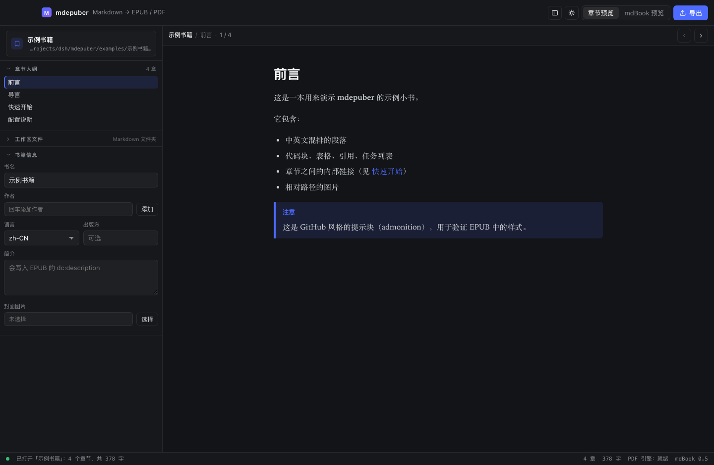
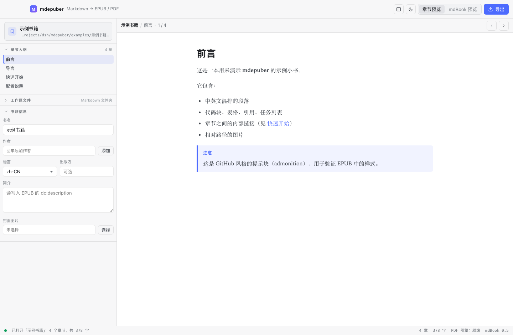
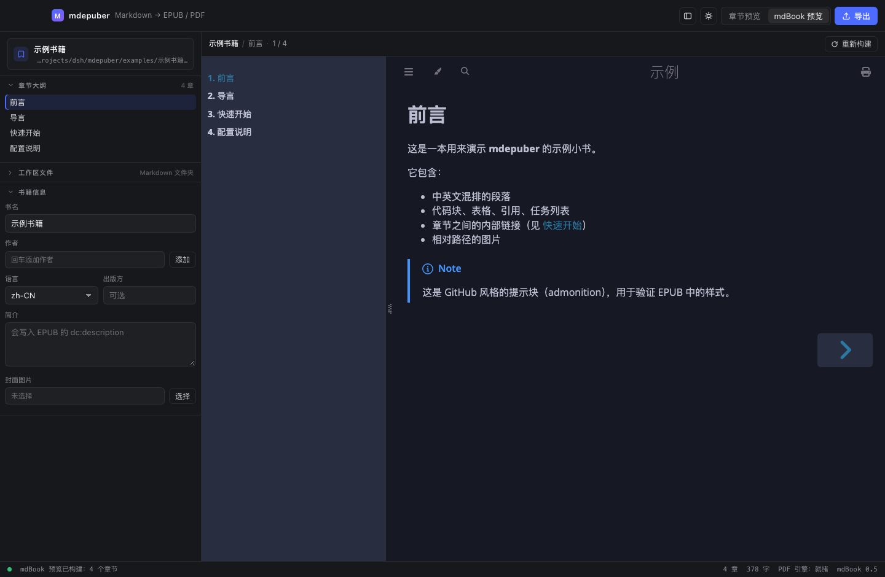
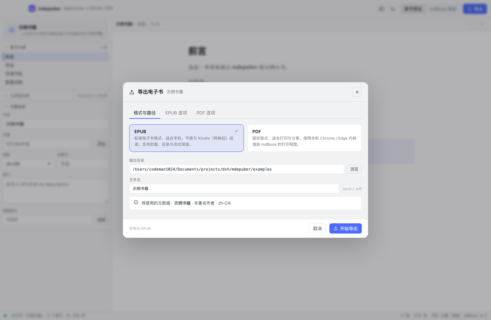
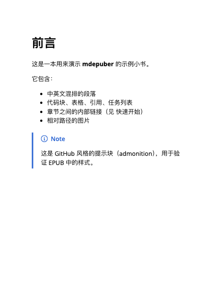

# mdepuber

把 **Markdown 文件**或**包含 Markdown 的文件夹**转换成 **EPUB** 或 **PDF** 电子书的桌面客户端。

界面参考 DeepSeek Harness 的桌面端布局：**左侧工作区、右侧预览、右上角导出**，
并且**支持深色 / 浅色两套主题**（标题栏右上的 ☀/☾ 按钮切换）。

深色（默认）：



浅色：







渲染内核是 [mdBook](https://rust-lang.github.io/mdBook/)：mdepuber 不做自己的 Markdown 方言，
而是直接复用 mdBook 的 `book.toml` / `SUMMARY.md` / 预处理器 / HTML 渲染器。

```
Markdown 文件 / 文件夹 / mdBook 项目
        │
        │  ① mdBook 载入 SUMMARY.md，运行 links / index 预处理器
        ▼
   mdBook HTML 输出  ──────────►  右侧「mdBook 预览」iframe（自带主题、侧栏、搜索）
        │
        ├─ ② mdbook-markdown 渲染每一章为 XHTML ──► epub-builder ──► .epub
        │
        └─ ③ mdBook 的 print.html + 打印样式表 ──► 无头 Chromium ──► .pdf
```

---

## 功能

| 能力 | 说明 |
| --- | --- |
| 三种输入 | 单个 `.md`、Markdown 文件夹、完整 mdBook 项目（含 `book.toml`） |
| 章节顺序 | 有 `SUMMARY.md` 就用它；没有则按“自然排序”（`ch2` 在 `ch10` 前），`README.md`/`index.md` 自动置前 |
| 目录页 | 「书籍信息」面板里的「生成目录页」勾选框，在**封面之后**插入一页可见目录；可选列到一、二或三级标题。EPUB 与 PDF 都会生成 |
| Front matter | 解析并剥离 YAML（`---`）与 TOML（`+++`）头部：`title` 用作章节标题，`date`/`tags`/`description`/`image`/`authors`/`lang`/`draft` 作为元数据展示，正文里再也不会出现头部原文 |
| 双预览 | 即时 Markdown 渲染预览 + mdBook 真实 HTML 整书预览（可搜索） |
| 深色 / 浅色主题 | 标题栏一键切换，写入 `localStorage`；首次启动跟随系统 `prefers-color-scheme`。切换时会同步设置原生窗口主题，因此 mdBook 预览也一起跟着变（见下文） |
| EPUB 3 / 2 | 封面、书名页、目录（nav + ncx）、章节层级、相对路径图片自动打包 |
| PDF | 可配置纸张（A3–A5/B5/Letter/Legal/自定义）、页边距、缩放、配色、页眉页脚、PDF 书签 |
| 链接与图片 | `.md` 章节互链自动改写为 EPUB 内部链接；相对路径图片自动复制到 `images/` |
| CJK 友好 | EPUB 内置中日韩字体栈；PDF 走系统字体并嵌入 CID 字体（已实测中文正常） |
| 元数据 | 书名、多作者、语言、出版方、简介、主题、版权、系列、UUID / 封面 |

被有意省略的部分（会以“提示”形式告知用户，而不是静默失败）：
外部预处理器（如 `mdbook-katex`）与第三方输出后端（如 `output.latex`）在转换时会被忽略，
因为它们的可执行文件没有随应用分发。

---

## 图标


设计说明：**一张折角文档 + Markdown 的 M**。折角文档是「文件/电子书」最通用的意象，
M 代表 Markdown 源；底板的蓝紫渐变与应用主题色一致。单字母而非两个字母，是因为
macOS 会以 16px 渲染图标（Finder 列表、菜单栏），两个字母在这个尺寸下必糊。

图标源文件在 [`assets/icon-1024.svg`](assets/icon-1024.svg)（已按 Apple 的 macOS 网格留白，
圆角方块占画布 824/1024），浏览器用的无留白版本在 [`public/icon.svg`](public/icon.svg)。
改完 source 后重新生成整套：

```bash
pnpm tauri icon assets/icon-1024.svg
```

## 快速开始

### 环境要求

- Rust ≥ 1.88（本仓库在 1.95 上验证）
- Node.js ≥ 20 + pnpm
- 生成 PDF 需要本机安装 Chrome / Chromium / Edge（macOS 上会自动在 `/Applications` 里查找）
- macOS 需要 Xcode Command Line Tools

### 运行

```bash
pnpm install
pnpm app:dev                        # 开发模式（tauri dev）
pnpm app:build                      # 打包 .app / .dmg
pnpm tauri build --bundles app      # 只打包 .app（不生成 dmg）
```

打包结果（本机实测）：

```
target/release/bundle/macos/mdepuber.app   11.50 MiB
target/release/mdepuber                    11.98 MB
release profile 编译耗时                     2m16s
```

### 只用命令行

`mdepub-cli` 是同一套核心的无界面入口，适合脚本与 CI：

```bash
cargo run -p mdepub-cli -- scan "examples/示例书籍"

cargo run -p mdepub-cli -- export "examples/示例书籍" \
  --out ./out --name "示例书籍" \
  --format epub --format pdf \
  --title "mdepuber 示例书籍" --author "张三" --author "李四" \
  --page-size A5 --margin 18 --theme light --font serif
```

---

## 项目结构

```
mdepuber/
├── Cargo.toml                 # Cargo workspace
├── crates/
│   ├── mdepub-core/           # ★ 转换核心（不依赖 GUI，可单独使用）
│   │   └── src/
│   │       ├── workspace.rs   #   路径探测、大纲解析、文件树、自然排序
│   │       ├── project.rs     #   合成/复用可构建的 mdBook 项目
│   │       ├── render.rs      #   驱动 mdBook 载入 + 预处理器 + HTML 渲染
│   │       ├── epub.rs        #   章节 XHTML 化、链接/图片改写、EPUB 打包
│   │       ├── pdf.rs         #   打印样式表生成 + 注入 print.html
│   │       ├── chrome.rs      #   浏览器探测与受监督的无头打印
│   │       └── model.rs       #   与前端共享的数据结构
│   └── mdepub-cli/            # 无界面 CLI
├── src-tauri/                 # Tauri 2 桌面外壳
│   └── src/
│       ├── lib.rs             #   窗口、状态、mdepub:// 协议注册
│       ├── commands.rs        #   open_workspace / build_preview / export_book / open_path
│       └── preview.rs         #   私有 URI scheme，把 mdBook 输出喂给 iframe
├── src/                       # React + TypeScript 前端
│   ├── App.tsx                #   布局与状态编排
│   ├── components/            #   Sidebar / FileTree / PreviewPane / ExportDialog / StatusBar
│   └── lib/                   #   Tauri 桥接 + markdown-it 渲染
└── examples/示例书籍/          # 用于端到端验证的样例书
```

---

## 关键实现说明

**为什么要有“合成项目”这一步。** mdBook 的公开 API 只接受「带 `book.toml` 和
`src/SUMMARY.md` 的目录」。为了支持散装 Markdown，`project.rs` 会在应用缓存里
（`<AppData>/mdepuber/projects/<hash>/`）搭一个临时项目：复制 Markdown 与同级资源、
按自然顺序生成 `SUMMARY.md`。用户的原始文件从不被修改。

**为什么是“就地构建 + 出树输出”。** 对已有的 mdBook 项目，`build.build_dir` 被指向
缓存目录，因此 `book/` 永远不会污染用户仓库。

**EPUB 是怎么做出来的。** 章节 Markdown 由 `mdbook-markdown`（mdBook 自己用的
pulldown-cmark 配置）渲染成 HTML，然后：

1. 为标题注入稳定 `id`（CJK 感知的 slug，冲突自动加 `-1`、`-2`）；
2. 用 `lol_html` 做真正的 DOM 级改写 —— 这一点很关键：正则会把代码块里的
   `href="x"` 当成属性误伤，而 lol_html 知道那是文本节点；
3. `.md` 链接映射到 `chapter-NNN.xhtml`，相对图片复制进 `images/`；
4. 交给 `epub-builder` 组装 mimetype / container.xml / content.opf / nav / ncx。

**目录页是怎么生成的。** EPUB 的阅读器导航（`nav.xhtml` / `toc.ncx`）和「书里能翻到的一页目录」
是两回事，后者需要自己造一页 XHTML 并放进 spine。mdepuber 从 mdBook 的 `Book` 树构造目录
（章节标题 + SUMMARY 嵌套层级 → `chapter-NNN.xhtml` 链接），`SUMMARY.md` 手写跳级（1 → 3）
时会做钳制，保证 `<ol>` 嵌套始终闭合。

PDF 那边不能用同一份数据，因为 mdBook 的 `print.html` 会**跨章节全局去重** heading id，
自己算锚点对不上。所以改成从生成好的 `print.html` 的 `<main>` 里把 `<h1>`~`<h3>` 连同
`id` 一起读回来，再插到 `<main>` 开头 —— 这样锚点一定解析得到。侧栏的 `<h2>` 因为不在
`<main>` 里而天然被排除。

**Front matter 是怎么处理的。** mdBook 0.5 **完全不支持** front matter：给它一篇以 `---`
开头的博客文，它会照常渲染 —— 开头的 `---` 变成一条分隔线，结尾的 `---` 把最后一个键变成
setext 二级标题，整块头信息糊成一团 H2。

mdepuber 的做法是把它当作一个真正的**预处理器**接进 mdBook 的管线：

```rust
let mut mdbook = MDBook::load_with_config(&project.root, config)?;
mdbook.with_preprocessor(FrontMatterPreprocessor);   // 渲染前剥离每章头部
```

这样 HTML 输出（预览 + PDF）和 EPUB 两条路径**同时**被修好 —— 不需要在每个渲染器里各写一遍。
`frontmatter.rs` 里的解析器刻意保守：只有当分隔符是**文件第一行**且存在**配对闭合符**时才认定为
头部，所以一篇恰好以水平线开头的文档不会被误伤；YAML 解析失败但形如 `key: value` 时也会剥离
（并标记 `tolerant`），避免把头部当正文渲染出去。

解析出的字段会回流到 UI：预览顶部显示日期、标签、草稿标记与摘要，章节标题优先取 `title:`，
单文件模式下 `image:` 会被解析成封面路径。

**预览里的相对路径图片。** 章节预览走的是 `mdepub://` 私有协议，markdown-it 输出的
`` 会被 webview 按应用自身的 origin 解析，结果就是一个破图占位符。
现在前端会把相对路径解析成绝对路径后改写成 `mdepub://localhost/@source<绝对路径>`，
由协议处理器校验「必须在当前工作区 `srcDir` 之内」（两侧都做 `canonicalize`，
`..` 与符号链接都无法逃逸）后回传文件。

**主题切换是怎么联动到 mdBook 预览的。** 这是本次实现里比较关键的一点：右侧的 mdBook
预览是 mdBook 自己生成的 HTML，跑在 iframe 里，应用改不到它的 DOM。但 mdBook 的主题选择
逻辑是「`localStorage['mdbook-theme']` 有值就用它，否则按 `prefers-color-scheme` 选
`default-theme` / `preferred-dark-theme`」。所以 mdepuber 做两件事：

1. 构建预览时把 `output.html.default-theme` 固定成 `light`、`preferred-dark-theme`
   固定成 `navy`（只影响预览，不影响导出，也不会改用户的 `book.toml`）；
2. 切换主题时调用 `getCurrentWindow().setTheme('light' | 'dark')`，把 webview 的
   `prefers-color-scheme` 一起改掉 —— 于是 iframe 里的 mdBook 会**实时**跟着切，无需重新构建。

副作用：mdBook 预览里自带的画笔（主题）按钮在选择过一次后会写入 localStorage，
之后就以那次选择为准（这和 mdBook 本身的行为一致）。

**PDF 是怎么做出来的。** mdBook 的 HTML 渲染器本来就会生成一个包含全书的
`print.html`。mdepuber 把生成的 `@page`/配色样式直接注入这个文件（写成
`print-mdepub.html`），再交给无头 Chromium 打印。这里有两个踩过的坑：

- Chrome 会派生出比父进程活得更久的子进程并继承管道，`Command::output()` 可能**永不返回**；
  因此打印采用「重定向到文件 + 自建超时看门狗 + 轮询 PDF 大小稳定」的方式。
- `additional-css` 指向书根之外时，mdBook 会在 HTML 里写出绝对路径；注入 `<style>` 更稳。

---

## 验证情况

在本机（macOS 27.2 / arm64，Rust 1.95，Chrome 已安装）对 `examples/示例书籍` 实测：

三种输入都做了端到端导出（每种都有 EPUB + PDF）：

| 输入 | 识别结果 | 章节 | EPUB | PDF |
| --- | --- | --- | --- | --- |
| `examples/示例书籍/`（文件夹） | `Folder`，自然排序 | 4 | 12 KB | 266 KB / A4 |
| `examples/mdbook-project/`（含 `book.toml`） | `MdBook`，就地构建 | 4（含二级章节） | 6 KB | 131 KB / A4 |
| `examples/单篇文章.md`（单文件） | `SingleFile` | 1 | 4 KB | 88 KB / A5 |

**EPUB 结构校验**（全部通过）：

- `mimetype` 是压缩包第一个条目且为 `ZIP_STORED`，内容 `application/epub+zip` ✅
- `META-INF/container.xml` / `OEBPS/content.opf` / `nav.xhtml` / `toc.ncx` / `stylesheet.css` 齐全 ✅
- 所有 `.xhtml` 都能被 XML 解析器解析（格式良好，无未闭合标签）✅
- 中文正文完整；`[快速开始](02-快速开始.md)` → `chapter-003.xhtml`；相对图片 → `images/001-diagram.svg` ✅
- 封面：`cover.png` + `properties="cover-image"` + `<meta name="cover">` + 封面页进 spine 首位 ✅
- 多作者：`book.toml` 的 `authors` 与 `--author` 都会产出独立的 `dc:creator` ✅
- 标题 id 为 CJK 感知的 slug，重名自动 `-1` / `-2`；二级章节在 `nav.xhtml` 中正确嵌套 ✅

**PDF 校验**：

| 文件 | 页数 | MediaBox | 书签 | 嵌入字体 |
| --- | --- | --- | --- | --- |
| `示例书籍.pdf`（A5） | 9 | `0 0 420 594.96` | ✅ | `/FontFile2` + CIDFontType2 ✅ |
| `mdbook-project.pdf`（A4） | 7 | `0 0 594.96 841.92` | ✅ | ✅ |
| `单篇文章.pdf`（A5） | 1 | `0 0 420 594.96` | ✅ | ✅ |

首页渲染截图（`sips` 转 PNG 后肉眼确认）：中文正常、标题层级、列表、GitHub admonition 提示块、页边距均正确。



**Front matter 端到端验证**（`examples/博客文章/`，结构与 `content/zh/posts/2026/09/<slug>/index.md` 一致）：

| 检查项 | 结果 |
| --- | --- |
| 章节标题取自 `title:` | 「软件工程亡了」「一周优秀网站精选推荐：Vol.01」「末法时代与末人」三个标题全部正确（含 TOML 语法的带冒号引号标题） |
| EPUB 各章 `<title>` | 与 front matter 一致 |
| EPUB / mdBook HTML 头部泄漏 | 扫描 9 个 HTML + 6 个 XHTML，针对 `title:`/`date:`/`tags:`/`description:` 特征串检查 → **0 处泄漏** |
| PDF 首页渲染 | 正文正常，无头部残留 |
| 元数据展示 | 预览顶部渲染出 `2026-09-19 12:16:39` + 四个中文标签 + 摘要 |
| 相对图片 | `images/arxiv.png` 正常显示（此前是破图占位符） |

**目录页验证**：

| 检查项 | 结果 |
| --- | --- |
| 有封面时的 EPUB spine 顺序 | `cover.xhtml` → `toc-page.xhtml` → `titlepage.xhtml` → 章节 1..N |
| 目录页 XHTML | 通过 XML 解析；链接指向 `chapter-001/002/003.xhtml` |
| 目录页进入导航 | `nav.xhtml` 中含「目录」 |
| PDF 首页 | 渲染确认：标题「目录」+ 三个章节，二级标题缩进 |
| 不勾选时 | EPUB 里不出现 `toc-page.xhtml`（行为与改动前一致） |
| 目录层级 = 1 | `<ol>` 只有一层，且深层条目被折叠而非丢弃 |
| 手写 SUMMARY 跳级 | `<ol>`/`<li>` 开闭标签数量平衡 |

**单元测试**：`cargo test --workspace` → 44 passed（核心 38 + Tauri 6）。
`cargo build --workspace` 零警告。

**编译**：`cargo build --workspace` 与 `pnpm build`（`tsc --noEmit && vite build`）均无错误、无警告。

**主题**：深色 / 浅色两套 token 均在本机用真实前端 bundle 渲染核对（1440×940），
深浅两态下侧栏、预览、导出对话框、状态栏配色均正确，深色相较改造前无回归；
浅色态下的 mdBook 预览也确认为 mdBook 自身的 light 主题。

UI 截图说明：桌面截图受限于当前会话的屏幕录制权限（`screencapture` 被 TCC 拒绝），
因此上面前两张 UI 截图是用**真实构建产物**（真实 `dist/` 前端 bundle + 真实
`mdepub scan --json` 数据 + 真实 mdBook HTML 输出）在无头 Chrome 中以 1440×940
渲染得到的，代码路径与桌面端一致，仅替换了 IPC 传输层。

---

## 已知限制

- PDF 依赖本机 Chromium 内核（可用 `MDEPUB_BROWSER` / `CHROME_PATH` 指定）；未安装时
  UI 会在状态栏提示“PDF 引擎：不可用”，EPUB 导出不受影响。
- 外部预处理器与第三方输出后端不参与转换（原因见上）。
- 单文件模式会连同**同级两层内的非 Markdown 资源**一起复制（上限 6000 个文件 / 512 MB），
  以便相对路径图片能正常工作。
- `pdf.printBackground` 目前依赖 Chromium 的默认打印行为；如需强制，请在「附加 CSS」
  里加 `html { -webkit-print-color-adjust: exact; }`。

## 环境变量

| 变量 | 作用 |
| --- | --- |
| `MDEPUB_BROWSER` / `CHROME_PATH` | 指定用于生成 PDF 的浏览器可执行文件 |
| `MDEPUBER_CACHE_DIR` | 覆盖构建缓存目录（便携模式 / 测试用） |

## 许可

MIT
